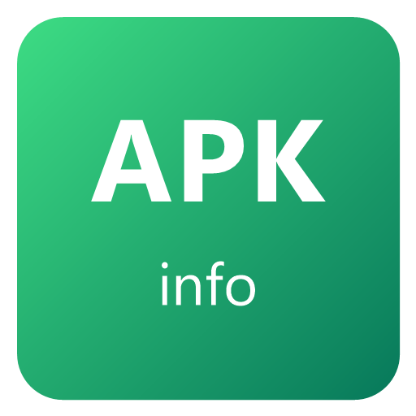
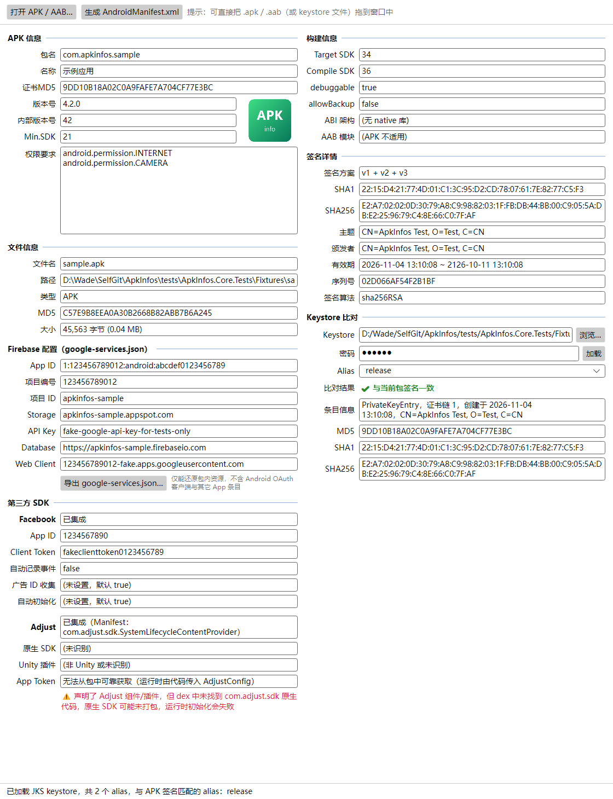

<div align="center">



# ApkInfos

**跨平台的 APK / AAB 信息查看工具**（Windows / macOS）

打开或拖入 `.apk` / `.aab`，一眼看清包名、版本、权限、签名、构建信息、Firebase / Facebook / Adjust 配置，<br/>
还能与 Keystore 比对签名、导出带中文注解的 AndroidManifest.xml。

[](https://github.com/meleke/ApkInfos/releases/latest)
[](LICENSE)


</div>



## ✨ 功能

| 分类 | 内容 |
|---|---|
| **APK 信息** | 包名、应用名称（优先中文）、证书 MD5、版本号、内部版本号、Min SDK、权限列表、应用图标 |
| **构建信息** | Target SDK、Compile SDK、debuggable、allowBackup、ABI 架构、AAB 模块列表 |
| **签名详情** | 签名方案（v1 / v2 / v3 / v3.1）、SHA1、SHA256、主题、颁发者、有效期、序列号、签名算法 |
| **Keystore 比对** | 加载 `.jks` / `.keystore` / `.p12` / `.pfx`，列出所有 alias 及指纹，自动判断是否与当前包签名一致 |
| **Firebase 配置** | 从包内资源还原 google-services.json 的关键字段，可导出一份最小可用的 `google-services.json` |
| **第三方 SDK** | Facebook（App ID、Client Token、各开关）与 Adjust（是否集成、原生 / Unity 版本），并提示常见配置错误 |
| **AndroidManifest.xml** | 还原为可读 XML，默认附带**中文注解**（权限含义、危险权限、组件所属 SDK、启动入口、深度链接等） |
| **文件信息** | 文件名、路径、类型、MD5、大小 |

- 同时支持 **APK** 和 **AAB**（Android App Bundle）
- 纯本地解析，**不联网、不上传任何数据**，也不依赖 JDK / Android SDK
- 单个可执行文件，无需安装 .NET 运行库

## 📥 下载

前往 [**Releases**](https://github.com/meleke/ApkInfos/releases/latest) 下载最新版本：

| 系统 | 文件 | 说明 |
|---|---|---|
| Windows 10 / 11（64 位） | [`ApkInfos-win-x64.zip`](https://github.com/meleke/ApkInfos/releases/latest/download/ApkInfos-win-x64.zip) | 解压得到 `ApkInfos-win-x64.exe`，双击运行 |
| macOS 12+（Apple 芯片 M1 / M2 / M3 / M4…） | [`ApkInfos-osx-arm64.zip`](https://github.com/meleke/ApkInfos/releases/latest/download/ApkInfos-osx-arm64.zip) | 解压得到 `ApkInfos.app` |
| macOS 12+（Intel 芯片） | [`ApkInfos-osx-x64.zip`](https://github.com/meleke/ApkInfos/releases/latest/download/ApkInfos-osx-x64.zip) | 解压得到 `ApkInfos.app` |

> 不确定 Mac 是哪种芯片：点击屏幕左上角的苹果菜单 →「关于本机」，「芯片」一栏写 Apple M… 选 arm64，写 Intel 选 x64。

### Windows 首次运行

程序没有购买代码签名证书，首次运行可能出现「Windows 已保护你的电脑」：点击 **更多信息 → 仍要运行** 即可。
首次启动需要解压内置组件，可能要等 10 到 20 秒，之后启动只需 2 到 3 秒。

### macOS 首次运行

mac 版未经 Apple 签名和公证，解压后请在「终端」执行一次（把路径换成实际位置，可直接把 `ApkInfos.app` 拖进终端窗口得到路径）：

```bash
xattr -cr ApkInfos.app
```

```bash
codesign --force --deep -s - ApkInfos.app
```

第一条去掉下载隔离标记，第二条做本机签名（Apple 芯片要求可执行文件必须带签名）。之后即可双击打开，也可以拖到「应用程序」文件夹。

## 🚀 快速上手

1. 打开 ApkInfos，把 `.apk` 或 `.aab` **拖进窗口**（或点「打开 APK / AAB…」）。
2. 各项信息自动显示，所有文本框都可以选中复制。
3. 需要核对签名时，在「Keystore 比对」中选择 keystore、输入密码、回车，选中的 alias 会显示 ✔ 一致 / ✘ 不一致。
4. 点「生成 AndroidManifest.xml」查看带中文注解的 Manifest，可复制或另存为。

Windows 下还可以把 APK 直接拖到 `ApkInfos-win-x64.exe` 图标上打开，或在命令行执行 `ApkInfos-win-x64.exe 路径\xxx.apk`。

👉 详细说明见 [使用说明](docs/USAGE.md)。

## ❓ 常见问题

<details>
<summary><b>为什么拿不到 Adjust 的 App Token？</b></summary>

App Token 是运行时由代码传给 `AdjustConfig` 的（可能写在 C# / Java 代码、Unity 场景，甚至从服务器下发），不在任何固定位置，无法可靠提取。工具会显示 Adjust 是否集成及其版本，并在「声明了组件但缺少原生代码」时给出提示。
</details>

<details>
<summary><b>导出的 google-services.json 和原文件一样吗？</b></summary>

不完全一样。Google Services 插件只把部分字段编译进包里，原文件中的 Android OAuth 客户端（含证书哈希）和同项目其它 App 的条目不在包内，无法还原。导出的是一份「最小可用」版本。
</details>

<details>
<summary><b>Keystore 不输密码可以吗？</b></summary>

JKS / JCEKS 格式可以：不输密码时仍能列出 alias 和证书，只是不校验完整性。PKCS12（.p12 / .pfx）必须输入正确的密码。
</details>

<details>
<summary><b>有些包没有显示图标？</b></summary>

部分包（如手表应用、某些工具类应用）在 Manifest 中本身就没有声明图标；图标若只有矢量 XML 也无法显示。可用 `aapt2 dump badging` 对照确认。
</details>

<details>
<summary><b>中文注解会改动 Manifest 内容吗？</b></summary>

不会。注解以 XML 注释 `<!-- -->` 的形式写在元素前，不影响任何属性；在查看窗口取消勾选「中文注解」即可得到原始 XML。
</details>

## 🛠️ 从源码构建

需要 [.NET 9 SDK](https://dotnet.microsoft.com/download/dotnet/9.0)：

```bash
git clone https://github.com/meleke/ApkInfos.git
```

```bash
cd ApkInfos
```

```bash
dotnet run --project src/ApkInfos.App
```

运行测试、打包发布等请看 [开发与发布](docs/BUILD.md)。

## 📁 项目结构

```
src/ApkInfos.Core/      解析库：AXML、resources.arsc、AAB protobuf、签名块、Keystore、SDK 识别、Manifest 注解
src/ApkInfos.App/       Avalonia 桌面界面
tests/                  xUnit 单元测试（Fixtures 为自签名的测试样本与 keystore）
tools/                  图标与测试样本生成脚本
docs/                   使用说明、开发文档与截图
publish.ps1             一键发布 Windows / macOS 产物
```

## 📄 许可证

本项目基于 [Apache License 2.0](LICENSE) 开源。

## 👤 作者

**Wade.liuyu** — [meleke_ly@126.com](mailto:meleke_ly@126.com)

欢迎提交 [Issue](https://github.com/meleke/ApkInfos/issues) 反馈问题或建议。
