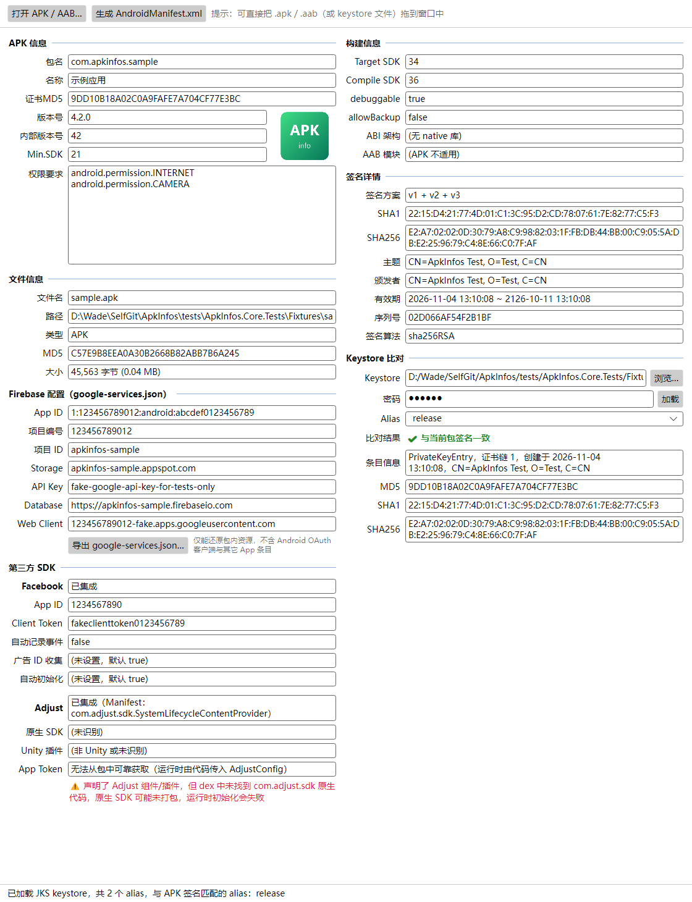
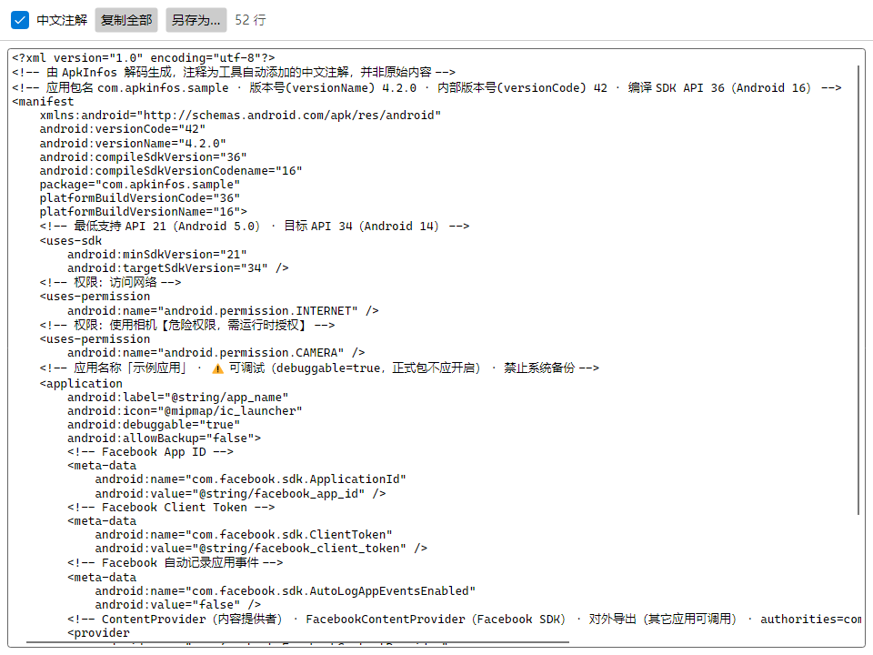

# 使用说明

[← 返回首页](../README.md)

- [打开文件](#打开文件)
- [APK 信息](#apk-信息)
- [构建信息](#构建信息)
- [签名详情](#签名详情)
- [Keystore 比对](#keystore-比对)
- [Firebase 配置](#firebase-配置)
- [第三方 SDK](#第三方-sdk)
- [AndroidManifest.xml 与中文注解](#androidmanifestxml-与中文注解)
- [文件信息](#文件信息)

## 打开文件

支持 `.apk` 与 `.aab`，任选一种方式：

- 把文件**拖进窗口**
- 点击工具栏「**打开 APK / AAB…**」
- Windows：把文件拖到 exe 图标上，或命令行 `ApkInfos-win-x64.exe 路径\xxx.apk`

把 keystore 文件（`.jks` / `.keystore` / `.p12` / `.pfx`）拖进窗口，会自动填入「Keystore 比对」的路径。

解析在后台进行，大文件（如 2 GB 的游戏包）主要耗时在计算文件 MD5 上。底部状态栏显示解析结果和提示信息。

> 所有文本框都是只读的，但可以选中、复制。

## APK 信息

| 字段 | 来源 / 说明 |
|---|---|
| 包名 | `manifest@package` |
| 名称 | `application@android:label`，引用字符串资源时按 简体中文 → 中文 → 默认 → 英文 的顺序取值 |
| 证书MD5 | 主签名证书的 MD5（大写、无冒号，与常见开放平台格式一致） |
| 版本号 | `android:versionName` |
| 内部版本号 | `android:versionCode` |
| Min.SDK | `uses-sdk@android:minSdkVersion` |
| 权限要求 | 所有 `uses-permission` / `uses-permission-sdk-23` |
| 图标 | `application@android:icon`，取最高密度的 PNG / WebP；自适应图标取前景层 |

## 构建信息

| 字段 | 说明 |
|---|---|
| Target SDK | `targetSdkVersion` |
| Compile SDK | `compileSdkVersion`，没有时取 `platformBuildVersionCode` |
| debuggable | 未声明时显示「false (默认)」。正式包应为 false |
| allowBackup | 未声明时显示「true (默认)」 |
| ABI 架构 | `lib/<abi>/` 下的目录，如 `arm64-v8a, armeabi-v7a` |
| AAB 模块 | 仅 AAB：base 与各动态功能模块 / 资源包 |

## 签名详情

- **签名方案**：检测 v1（JAR 签名）、v2、v3、v3.1。AAB 只有 jarsigner 签名，显示「v1 (jarsigner)」；未签名的包显示「未签名」。
- **SHA1 / SHA256**：冒号分隔，与 `keytool -printcert -jarfile` 输出一致，可直接填到 Firebase、Google 登录、微信等平台。
- 若不同方案使用了不同证书（如 v3 密钥轮换），会提示并显示 v3 的证书。

## Keystore 比对

1. 点「浏览…」选择 keystore（或直接拖入窗口）。
2. 输入 storepass，按回车或点「加载」。
3. 下拉框列出全部 alias，并**自动选中与当前包签名一致的那个**；底部状态栏会提示匹配的 alias。
4. 比对结果：✔ 与当前包签名一致（绿色）/ ✘ 与当前包签名不一致（红色）。

| 格式 | 说明 |
|---|---|
| JKS / JCEKS（`.jks`、`.keystore`） | 不输密码也能列出 alias（不校验完整性）；密码错误会提示 |
| PKCS12（`.p12`、`.pfx`，Android Studio 新建的 keystore 默认也是这种格式） | 必须输入正确密码 |

> 比对按证书 SHA-256 进行。只读取证书，不会解密或导出私钥。

## Firebase 配置

`google-services.json` 本身不会打进包里，Google Services 插件（及 Unity Firebase SDK）会把它转成以下字符串资源，工具据此还原：

| 界面字段 | 资源名 | google-services.json 字段 |
|---|---|---|
| App ID | `google_app_id` | `client_info.mobilesdk_app_id` |
| 项目编号 | `gcm_defaultSenderId` | `project_info.project_number` |
| 项目 ID | `project_id` | `project_info.project_id` |
| Storage | `google_storage_bucket` | `project_info.storage_bucket` |
| API Key | `google_api_key` | `api_key.current_key` |
| Database | `firebase_database_url` | `project_info.firebase_url` |
| Web Client | `default_web_client_id` | `oauth_client`（client_type = 3） |

点「**导出 google-services.json…**」可保存一份最小可用的配置文件。原文件中的 Android OAuth 客户端（含证书哈希）与同项目其它 App 条目不在包内，无法还原。

## 第三方 SDK

### Facebook

读取 `com.facebook.sdk.*` meta-data（引用时解析字符串资源）：App ID（自动去掉 `fb` 前缀）、Client Token、自动记录事件、广告 ID 收集、自动初始化。会提示以下问题：

- App ID 为 0（疑似未配置）
- 缺少 Client Token（Facebook SDK v13 起必填）
- `FacebookContentProvider{AppID}` 中的 ID 与配置不一致

### Adjust

- **是否集成**：依据 Manifest 中的 `com.adjust.sdk.*` 组件、dex 中的 Adjust 代码、Unity 侧的 AdjustSdk 插件
- **原生 SDK 版本**：如 `android5.4.2`
- **Unity 插件版本**：如 `unity5.4.2`（IL2CPP 与 Mono 构建都支持）
- 声明了组件或插件、但 dex 里没有原生代码时，会提示「原生 SDK 可能未打包」
- **App Token 无法获取**：它在运行时由代码传入 `AdjustConfig`，不在任何固定位置

## AndroidManifest.xml 与中文注解

点击工具栏「**生成 AndroidManifest.xml**」，APK 的二进制 XML 与 AAB 的 protobuf XML 都会还原为可读的 XML（属性逐行排列，与 Android Studio 风格一致）。

默认勾选「**中文注解**」，以 XML 注释写在元素前，不改动任何原始内容：

| 元素 | 注解内容 |
|---|---|
| `manifest` / `uses-sdk` | 版本、API 级别对应的 Android 版本（如「API 34（Android 14）」）、安装位置 |
| `uses-permission` | 权限中文含义，标注【危险权限】【特殊权限】【系统级权限】，以及 maxSdkVersion 适用范围 |
| `application` | 应用名称、自定义 Application 类、⚠ debuggable、⚠ 明文 HTTP、备份、so 库解压等 |
| 四大组件 | 类型、所属 SDK、【启动入口】、是否对外导出（及 Android 12 未声明 exported 提示）、启动模式 / 屏幕方向 / configChanges 含义 |
| `intent-filter` | 桌面入口、深度链接 `scheme://host/path`（含 App Links）、开机启动 / FCM 推送等常见 action |
| `meta-data` | AdMob、FCM、Facebook、Unity、Google Play 拆分包等常见配置项 |
| `<queries>` | 可查询的应用（如 LINE、Facebook）与 Intent |

- 取消勾选即为原始 XML；「复制全部」「另存为…」都按**当前显示的内容**输出。
- 注解中带 ⚠ 的条目通常值得检查，例如正式包开启了 debuggable。

## 文件信息

文件名、完整路径、类型（APK / AAB）、文件 MD5（与 `certutil -hashfile xxx MD5` 或 `md5` 命令一致）、大小。
